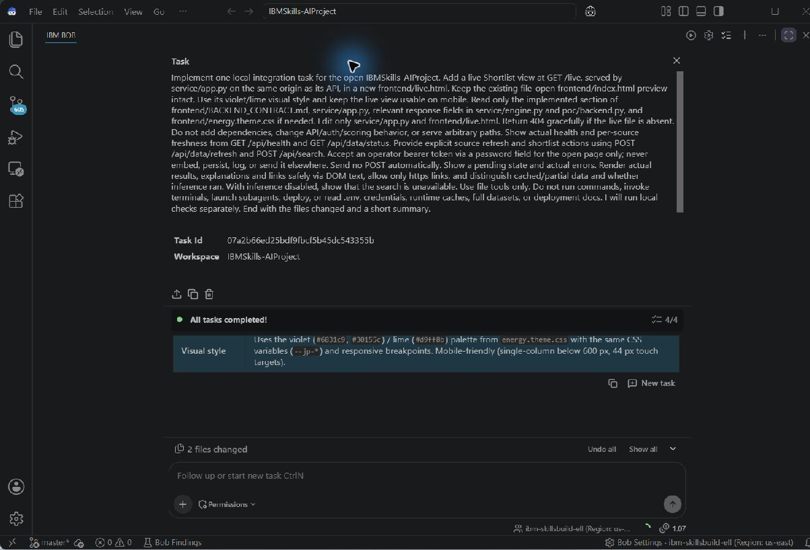
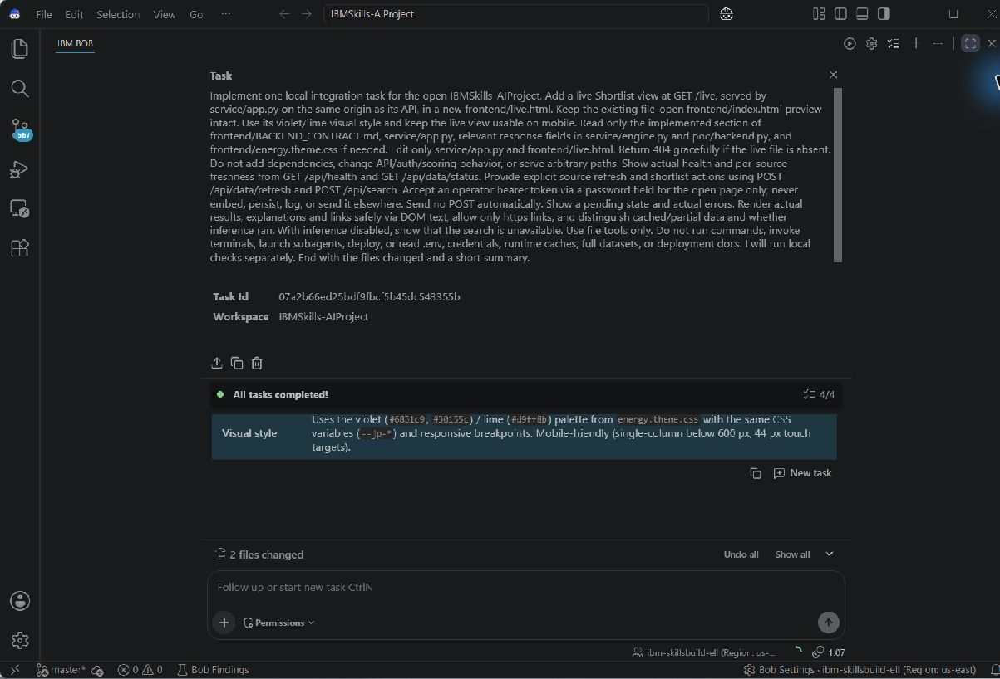

# IBM Bob task evidence

The November 10 completed task built the initial live shortlist frontend and GET /live route. The task was reopened on November 20 in the ibm-skillsbuild-ell account without starting a new AI task. The expanded task-header screenshot includes its task ID/workspace and the visible 1.07 usage at the bottom. The earlier completed-task screenshot is also retained. No new Bob inference was used to recover this evidence.

